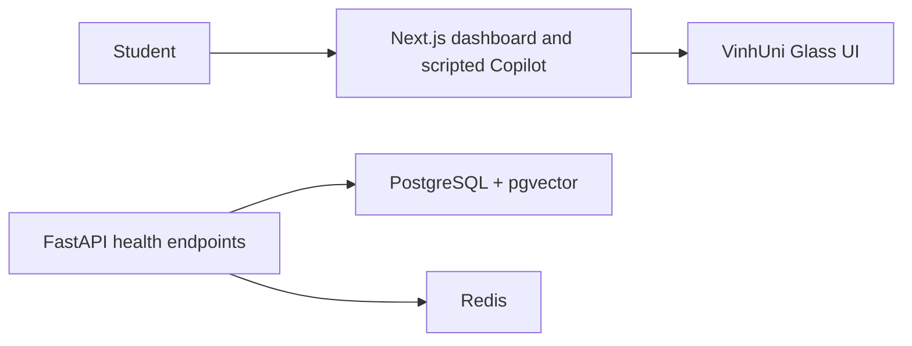

# Architecture

## Foundation

The UI reads typed synthetic fixtures in `apps/web` and has no API or AI provider connection. Reusable primitives belong to `packages/glass-ui`. FastAPI lives in `apps/api`. Compose and container build files define the local topology, with persistent PostgreSQL storage and loopback-only app ports. API readiness checks PostgreSQL for pgvector and pings Redis.

`database` contains PostgreSQL initialization and will hold migration assets. `core` is reserved for shared domain rules where reuse is needed. `knowledge` and `training` are for authorized source manifests and synthetic evaluation data. Browser and web unit tests live in `tests`. API tests live beside the API.

## Planned service boundaries

- Academic modules own registration, grades, GPA, course catalogs, timetable, tuition, notices and support. Faculty, department, program and identity management belong to the administration boundary.
- The Supervisor coordinates Academic, Enrollment, Scheduler, Account, Finance, Support and Career agents using LangGraph. Provider adapters for Gemini, Ollama and OpenAI-compatible APIs sit behind the workflow boundary.
- RAG reads vetted, source-attributed documents with authorization filters. Retrieved text is untrusted. Personal memory is opt-in, isolated by account and deletable.
- Backend tools have fixed schemas and use the same permission checks and transaction boundaries as user-facing endpoints. For consequential actions, show a server-created preview, bind approval to the user and action, then revalidate and apply idempotently. Record status and actor without logging secrets or full prompts. Agent tools never accept arbitrary SQL or mutate grades, passwords, roles or permissions.
- OR-Tools generates schedules with hard constraints for conflicts and eligibility. Celery and Redis support future retryable jobs and reminders with deduplication.

JWT, password hashing, RBAC, rate limits, prompt injection defenses, agent workflows and deployment hardening are subsequent phases.
